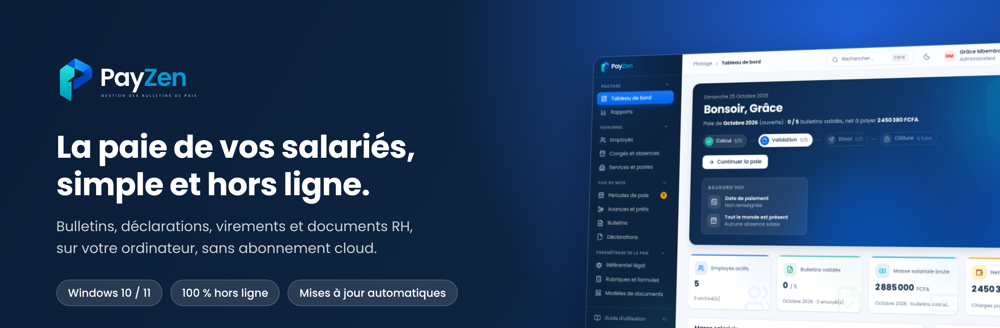
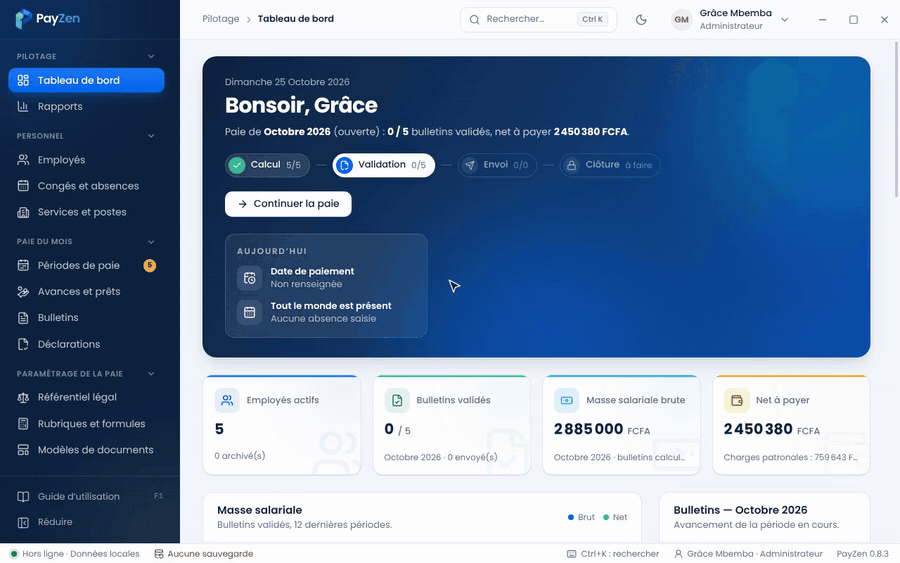
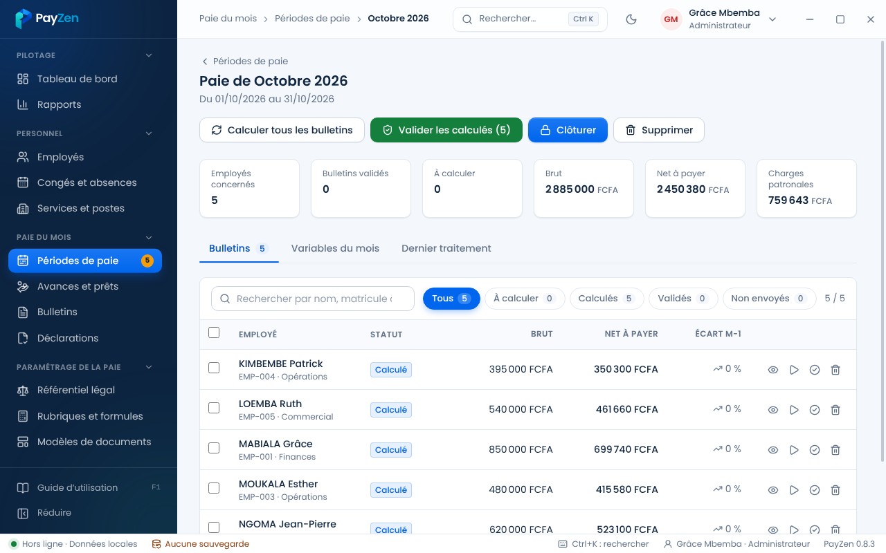
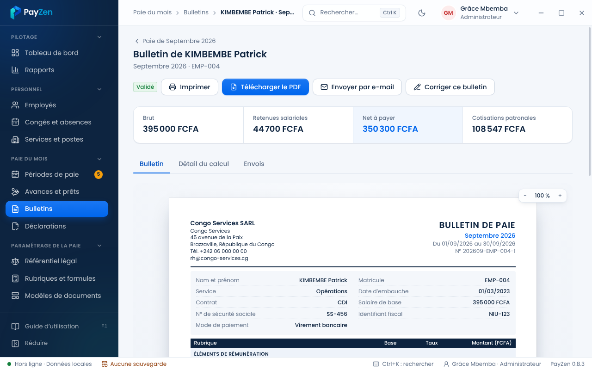
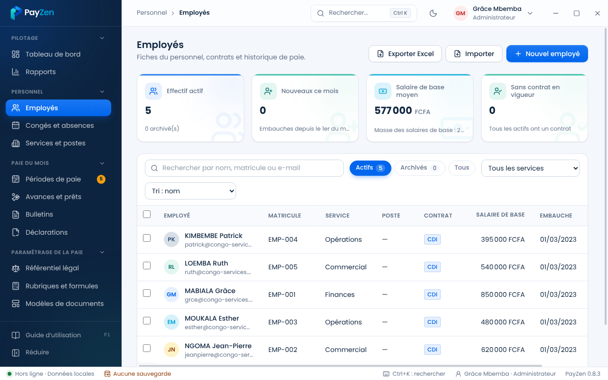

  

  <a href="https://github.com/Christmp19/payzen-releases/releases/latest"><b>⬇️ Télécharger la dernière version</b></a>
  &nbsp;·&nbsp; Windows 10 / 11 (64 bits)
  &nbsp;·&nbsp; Essai gratuit de 30 jours

---

**PayZen** est un logiciel de **paie** pour les entreprises. Il s'installe sur votre ordinateur et fonctionne **sans Internet** : vos données restent chez vous, sur votre poste.

Il prépare chaque mois les **bulletins de paie** de vos salariés, les déclarations, les virements et les documents RH. Il se met à jour tout seul quand une nouvelle version sort.

## La paie du mois en quelques clics

  

1. **Calculer** : tous les bulletins du mois d'un coup, avec les variables (heures, primes, absences, avances).
2. **Vérifier puis valider** : brut, retenues, net à payer et charges patronales, salarié par salarié.
3. **Remettre** : impression, PDF, ou envoi par e-mail à chaque salarié de **son seul bulletin**.
4. **Payer** : ordres de virement par banque, ou reçus individuels pour les paiements en espèces.

## Ce que fait PayZen

| | |
|---|---|
| 👥 **Employés** | Fiches, contrats, services et postes ; import et export Excel. |
| 🧾 **Bulletins** | Calcul automatique, validation, correction tracée, PDF à votre logo. |
| 🏖️ **Congés et absences** | Soldes, absences du mois reprises dans la paie. |
| 💸 **Avances et prêts** | Retenues mensuelles calculées d'office. |
| 🏦 **Virements** | Un ordre de virement par banque, ou reçus de paiement individuels. |
| 📑 **Déclarations** | État préparatoire CNSS, écritures comptables (Excel et PDF). |
| 📄 **Documents RH** | Attestation de travail, certificat, solde de tout compte ; modèles modifiables. |
| ✉️ **Envoi par e-mail** | Chaque salarié reçoit son bulletin, depuis votre propre adresse. |
| 🔒 **Sécurité** | Comptes et rôles, journal d'audit, sauvegardes chiffrées. |
| 🔄 **Mises à jour** | Automatiques et vérifiées (signature numérique). |

## Aperçu

<table>
  <tr>
    <td width="50%">
<b>Tableau de bord</b> : où en est la paie du mois
</td>
    <td width="50%">
<b>Paie du mois</b> : calculer, valider, clôturer
</td>
  </tr>
  <tr>
    <td width="50%">
<b>Bulletin</b> : imprimer, PDF, e-mail
</td>
    <td width="50%">
<b>Employés</b> : fiches et contrats
</td>
  </tr>
</table>

## Installer PayZen

1. Ouvrez la [dernière version](https://github.com/Christmp19/payzen-releases/releases/latest) et téléchargez **`PayZen-Setup-X.Y.Z.exe`**.
2. Double-cliquez sur le fichier téléchargé, puis suivez l'installation.
3. Au premier démarrage, créez votre **compte administrateur**, puis **notez votre clé de secours** : elle sert si le mot de passe est oublié.
4. Renseignez votre entreprise dans **Paramètres**, ajoutez vos employés, puis créez la première période de paie.

> **« Windows a protégé votre ordinateur » ?** Ce message apparaît parfois pour les nouveaux logiciels. Cliquez sur **Informations complémentaires**, puis sur **Exécuter quand même**.

**Mises à jour** : PayZen vérifie lui-même les nouvelles versions ; un clic sur **Installer et redémarrer** suffit. Une sauvegarde est faite juste avant, et vos données sont conservées.

## Essai et licence

- **Essai gratuit de 30 jours**, jusqu'à 5 salariés ; pendant l'essai, les bulletins portent la mention « ÉVALUATION ».
- Pour obtenir ou **renouveler votre licence**, **changer d'ordinateur** ou **débloquer l'horloge** : *Paramètres › Licence*. La demande part **en un clic** par e-mail, et vous recevez un fichier à double-cliquer.

  

Une licence expirée ne vous bloque jamais l'accès à vos données : consultation, impression, exports et sauvegardes restent possibles.

## Configuration requise

- Windows 10 ou 11, 64 bits.
- Internet seulement pour les mises à jour et l'envoi des e-mails.

## Contact

**PayZen**
📞 +221 77 369 09 58
✉️ [nzela.digital@gmail.com](mailto:nzela.digital@gmail.com)

---

Ce dépôt contient uniquement les installateurs de PayZen et les fichiers de mise à jour automatique. Les mises à jour sont signées numériquement : PayZen refuse tout fichier qui ne vient pas de l'éditeur.
